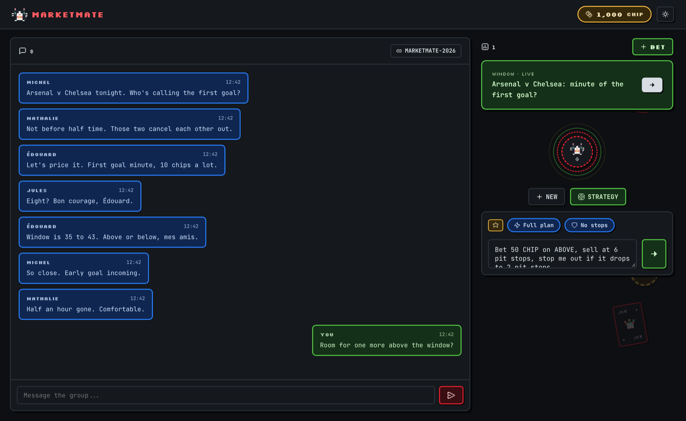
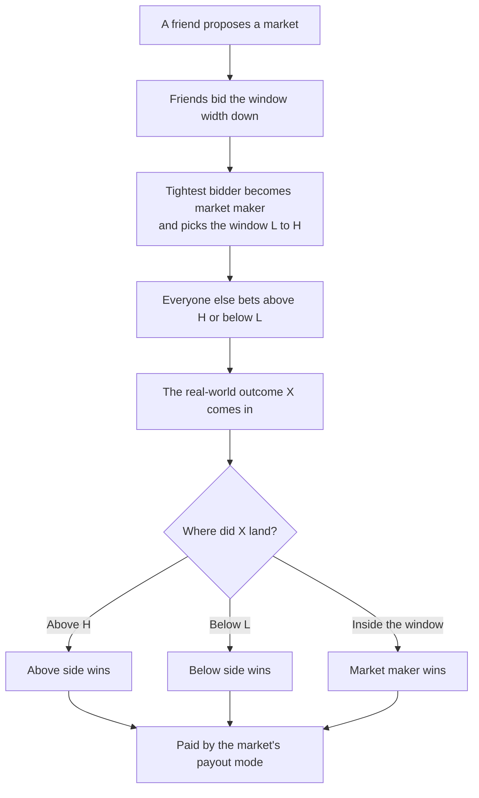

# MarketMate

Turn any argument in your group chat into a market. Friends bet play-money `CHIP` on a real order book, with a tuxedo cat dealer turning chat messages into bets.



## How a bet works



The market's creator picks the payout mode. `k` is the stake per lot, `w = H - L` is the window width, and `c` caps how many widths a bet can pay or lose.

| Mode | A winning bet pays |
| --- | --- |
| **Binary** | A flat `k` per lot |
| **Linear** | `k` per window width past the edge, up to `c` widths |
| **Log** | Like linear, on a log scale, for values that grow by ratio (needs `L > 0`) |
| **Pot** | The whole pot, split across the winning side by lots |

An outcome exactly on `L` or `H` counts as inside the window. Yes/no and stacked markets skip the auction and go straight to betting.

**Not yet in the UI:** bidding down (the first width confirmed wins, though the engine and `/sim` support the full auction) and choosing the log payout mode.

## Run it

Needs Docker, or Node 22+ and Python 3.

```bash
make dev
```

The app opens at http://localhost:5173, with the API on `:4000`. Stop it with `make dev-down`.

Run the backend tests:

```bash
cd backend && npm test
```

The bot works without keys using built-in rules. Set `GEMINI_API_KEY` or `OPENAI_API_KEY` on the backend for LLM parsing.

## Dev tools

`npm run dev` sets `DEV_TOOLS=1`, which enables `/api/dev/*` and `/api/demo/*`. Both return 404 in production.

- **Personas:** play as Édouard, Jules, André, Michel or Nathalie from the header. The choice is per browser tab.
- **Simulator:** http://localhost:5173/sim steps or skips through a scripted betting session. Opening it resets local data.

## Repo

| Path | What's there |
| --- | --- |
| `frontend/` | React app: chat, right rail, bet drawer |
| `backend/src/engine/` | Deterministic rules: auction, payouts, order book, ledger |
| `backend/src/worker/` | Hono API, bot agents, SQLite/D1 persistence |
| `SPEC.md` | Full product and engine spec |
| `TEAM_TASKS.md` | Open tasks |
