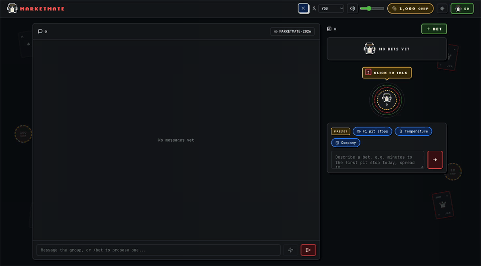
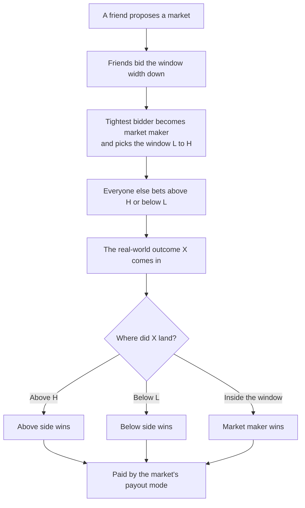

# MarketMate

[](https://github.com/Edgshirley/Agentverse_2026/actions/workflows/ci.yml)
[](LICENSE)

Turn any argument in your group chat into a market. Friends bet play-money `CHIP` on a real order book, with a tuxedo cat dealer turning chat messages into bets.



<sub>▶ [Watch with sound](docs/demo.mp4) · [Pitch deck](https://edgshirley.github.io/Agentverse_2026/pitch-deck.html) (arrow keys to move) · Built at the Agentverse 2026 hackathon</sub>

**Stack:** React + TypeScript (Vite) · TypeScript rules engine (Hono) · FastAPI gateway · Keycloak · Postgres · Redis · Gemini with Google Search · Docker Compose

## How a bet works



The market's creator picks the payout mode. `k` is the stake per lot, `w = H - L` is the window width, and `c` caps how many widths a bet can pay or lose.

| Mode | A winning bet pays |
| --- | --- |
| **Binary** | A flat `k` per lot |
| **Linear** | `k` per window width past the edge, up to `c` widths |
| **Log** | Like linear, on a log scale, for values that grow by ratio (needs `L > 0`) |
| **Pot** | The whole pot, split across the winning side by lots |

An outcome exactly on `L` or `H` counts as inside the window. Yes/no and stacked markets skip the auction and go straight to betting.

## Run it

Needs Docker. Without it, `make dev` falls back to the engine and UI only, with no login.

```bash
make dev
```

Open http://localhost:5173 and log in as `alice`, `bob`, `carol` or `dave` (password in `dev.env`). Stop it with `make dev-down`.

| Service | Port | Role |
| --- | --- | --- |
| `frontend` | 5173 | Vite UI, proxies `/api` to the gateway |
| `api` | 8000 | FastAPI gateway: login, sessions, WebSocket |
| `keycloak` | 8080 | Identity provider (dev only) |
| `engine` | internal | TypeScript rules engine, reachable only from `api` |
| `postgres`, `redis` | 5432, 6379 | Users and snapshots; sessions and the message bus |

Every `/api/*` call needs a session, and the gateway binds each action to the signed-in player. Browsers get live updates on `/api/v1/ws`.

For production, copy `prod.env.example` to `prod.env` and run `make prod`. Create the `spread-api` and `spread-ui` Keycloak clients once and set `KEYCLOAK_CLIENT_SECRET`.

Run the tests:

```bash
cd backend && npm test
```

```bash
make api-test
```

The bot runs on Gemini with Google Search: it drafts bets from plain text, briefs bidders with web facts and settles bets from published results. Put `GEMINI_API_KEY` in `secrets.env` for dev (copy `secrets.env.example`) or `prod.env` for production. Both are git-ignored; see [docs/CONTRIBUTING.md](docs/CONTRIBUTING.md). Without a key the bot reports that it's unavailable and never invents anything.

## Dev tools

Personas and the simulator need a run without the gateway, because the gateway binds every action to you:

```bash
cd backend && npm install && npm run dev
```

```bash
cd frontend && npm install && npm run dev
```

`npm run dev` sets `DEV_TOOLS=1`, which enables the dev and simulation routes. They return 404 in production.

- **Real or preset:** typed bets always call Gemini. The `PRESET` buttons use offline keyword rules and are labelled everywhere; they never call the AI.
- **Personas:** play as Édouard, Jules, André, Michel or Nathalie from the header. The choice is per browser tab.
- **Simulator:** the ▶ button in the header (or http://localhost:5173/sim) plays a scripted betting session in under 30 seconds, from your first chat message through MarketMate's suggestion to both markets settling. It resets local data when it starts.
- **Fake friends:** MAYA and THEO reply in chat whenever a bet is created or someone talks about betting, so the chat feels alive when you test on your own. They stay quiet while the simulator runs.

Lounge music (`frontend/public/audio/marketmate_lounge.m4a`) loops in every build, with mute and volume controls in the header. It starts on your first click, because browsers block autoplay, and it dips under each sound effect.

## Repo

| Path | What's there |
| --- | --- |
| `frontend/` | React app: chat, right rail, bet drawer |
| `api/`, `kc/` | FastAPI gateway and Keycloak setup |
| `backend/src/engine/` | Deterministic rules: auction, payouts, order book, ledger |
| `backend/src/worker/` | Hono API, bot agents, persistence |
| `SPEC.md` | Full product and engine spec |
| `docs/TEAM_TASKS.md` | Open tasks |

## Contributing

API keys must never reach GitHub. Read [docs/CONTRIBUTING.md](docs/CONTRIBUTING.md) before your first commit: it covers where keys live, the pre-commit check and what to do if one leaks. CI runs the engine tests, the API tests and the frontend build on every push and pull request.

## License

[MIT](LICENSE)
