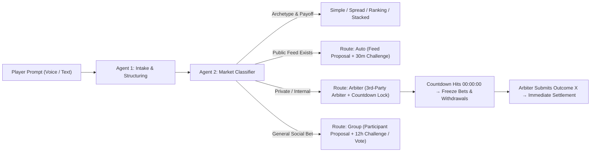

# MarketMate — Master Specification

**Date:** November 7, 2026  
**Currency:** Stokens (`CHIP` — play-money "Spread Tokens" only; integer balances, zero monetary value)  
** Aesthetic:** Full Dual-Theme Citadel Poker Terminal (`#000000` Live Terminal + `#FAFAFA` Strategy & Allocation Sheet)

---

## 1. Executive Summary & Core Pillars

**MarketMate** is a real-time social market-making and continuous trading application where friend groups run spread, binary, scalar, ranking, and stacked derivative markets on anything—from live football matches and tomorrow's weather to private office rankings. An AI multi-agent pipeline drafts markets, classifies payoff and oracle routes, enforces strategy risk guardrails, tracks live feeds, and proposes outcomes, while a deterministic zero-sum engine governs every `TOK`.

1. **Simple, Spread (`[L, H]`), & Stacked Markets** — Supports casual one-line propositions (*"24°C tomorrow"*), width-auction market-making (`[L, H]`), and **stacked (derivative) markets** that settle on the outcome, live odds path, volume, or player P&L of parent markets.
2. **Continuous Mark-to-Market & Dual Early Exit** — Markets stay live until the underlying event completes. Every trade, limit/stop fill, or withdrawal updates implied odds and each player's `live_equity` in real time. Supports both **P2P lot sales** (standing bids & ask listings for MM spread markets) and **anytime partial/full pool withdrawal** (`live_equity > 0`) for continuous markets.
3. **Public Limit & Stop Order Book ("Swing Map")** — Players place balance-backed limit and stop orders (`LIMIT_BUY`, `LIMIT_SELL`, `STOP_LOSS`, `TAKE_PROFIT`). All open orders are visible to the group so traders can spot liquidity walls and levels that will trigger cascading swings.
4. **Hybrid Entry: 1-Tap Manual Takes + AI Strategy Risk Gate** — Manual Over/Under buttons execute in **1 tap** for speed (< 30s from prompt to auction). When entering via **conversational voice or text strategy**, the bot enforces a **Hard Risk Gate**, requiring explicit confirmation of: (1) Strategy Summary, (2) Take-Profit target, and (3) Drawdown Floor (`min_balance_floor`) before activation.
5. **Voice-First & Text Modality** — Push-to-talk speech-to-intent lets players propose markets, dictate multi-leg strategies, or adjust stops by voice alongside standard text and 1-tap controls.
6. **Two-Stage AI Classification & 3rd-Party Oracle Resolution** — **Agent 1 (Intake)** structures raw prompts; **Agent 2 (Classifier)** assigns market archetype and resolution route (`Auto`, `Arbiter`, `Group`). Unverifiable private bets lock on a mandatory countdown and require a designated non-trading **3rd-Party Arbiter** to enter the official outcome.
7. **Full Dual-Theme Citadel Poker Terminal UI** — High-contrast monospaced interface combining a `#000000` Dark Live Terminal and a `#FAFAFA` Light Strategy & Allocation Sheet across five core exhibits: **Player Ring**, **Action Swimlanes**, **Branching Swing Tree**, **Heads-Up Telemetry Card**, and **Live Wire Trace**.
8. **Deterministic Zero-Sum Engine** — AI agents only invoke tools to return structured proposals. Only the deterministic market engine mutates state or balances, and every balance-affecting action requires explicit player confirmation.

---

## 2. Market Archetypes & Game Mechanics

### 2.1 Market Archetypes

| Archetype | Mechanics | Early Exit & Liquidity | Example |
| :--- | :--- | :--- | :--- |
| **Simple Market** | Quick binary (`Yes/No`), scalar/linear, or multi-outcome ranking market with dynamic odds calculated continuously from pool/order flow. | Anytime partial/full pool withdrawal (`p ∈ (0, 1]`) + public limit/stop order book. | *"I bet it will be 24°C tomorrow"* |
| **Spread / MM Market** | Width auction $\rightarrow$ narrowest bidder becomes Market Maker (`MM`) and quotes $[L, H]$ $\rightarrow$ takers go Over (buy at $H$) or Under (sell at $L$). | P2P position transfer via standing bids, ask listings, and auto-sell rules (plus optional live re-open auctions). | *"When will Arsenal score first?"* (0–95 min) |
| **Stacked (Meta) Market** | Derivative market referencing `parent_market_id`, settling on the parent's outcome, live odds trajectory, volume, or a participant's P&L. | Anytime partial/full pool withdrawal + public limit/stop order book until parent condition resolves. | *"Will Market M7's Over odds hit 75% before halftime?"* or *"Will Ana finish M7 with positive P&L?"* |

### 2.2 End-to-End Market Lifecycle

1. **Propose & Classify (< 30s target):** A player speaks or types a bet. **Agent 1 (Intake)** drafts the question, unit, bounds, resolution source/criteria, deadline, payoff mode, stake $k$ (`CHIP` per lot), and no-event fallback value. **Agent 2 (Classifier)** determines the archetype and resolution route (`Auto`, `Arbiter`, `Group`). The proposer confirms the draft card.
2. **Width Auction (Spread Markets):** Players bid range widths $w$; each bid must narrow the standing best by at least the minimum step. Closes after a **30s quiet period**.
3. **Quote:** The narrowest bidder becomes `MM` and sets lower bound $L$. The engine sets $H = L + w$ within the market bounds.
4. **Entry (1-Tap Take or Conversational Strategy):**
   - **Manual 1-Tap Take:** Players tap Over (buy at $H$) or Under (sell at $L$) for 1–3 lots (configurable 1–5 max). Takes remain hidden by default until the window closes.
   - **Conversational Voice/Text Entry:** Players state a thesis or conditional strategy; the bot parses it and enforces the **3-part Hard Risk Gate** before placing active positions or orders.
5. **Lock:** Hidden takes are revealed and each participant's worst-case liability moves to `escrow`.
6. **Live Trading, Order Book & Early Exit:**
   - The market stays open until event completion (or countdown expiry).
   - Live feeds update scores every 15s, refresh fair value, and post commentary.
   - Every trade, limit/stop trigger, or withdrawal immediately recalculates implied odds and broadcasts updated `live_equity` to all participants.
7. **Resolve:** Outcome $X$ is proposed by the live feed (`Auto`), the designated 3rd-party arbiter (`Arbiter`), or a participant (`Group`).
8. **Settle:** The engine computes zero-sum payoffs, routes integer rounding remainders to the `MM`, writes immutable ledger entries, and generates an AI calibration recap.

**Boundary Rule:** $X = L$ or $X = H$ counts as **inside** the range. Over wins strictly if $X > H$; Under wins strictly if $X < L$.

**Market Toggles:** Max lots (`1..5`) · Pass vs. forced trading · Hidden vs. visible takes (default: hidden) · Single `MM` re-quote after initial flow · Live re-open (fresh width auction at set milestones such as halftime).

**Auction & Quote Fallbacks:**
- **No width bids:** Proposer becomes `MM` at preset $w_{\max}$; if they decline, the market voids.
- **MM misses quote deadline (3 min):** `MM` forfeits an ante of $k$ `CHIP` to the next-narrowest bidder, who quotes at their own bid width. If no bidders remain, the market voids.
- **No takers:** Market voids and all escrowed `CHIP` return.

### 2.3 Payoff Modes, Escrow & Worked Golden Test

Fixed at market creation: $k$ = `CHIP` per lot, $w = H - L$, $c$ = cap in widths (default $3$).

| Mode | Payoff per Lot | Max Loss per Lot | Best For |
| :--- | :--- | :--- | :--- |
| **Pot** *(default)* | Winning side splits total pot pro-rata by lots; if $L \le X \le H$ (or winning side has 0 lots), `MM` takes the pot | Stake ($k$) | Casual play, any question |
| **Binary** | $+k$ if side wins, $-k$ otherwise | $k$ | Simplest fixed-risk bets |
| **Linear** | $k \cdot \mathrm{clamp}\!\left(\frac{\text{distance beyond } H \text{ or } L}{w}, -c, c\right)$ | $k \cdot c$ | Conviction sizing & hedging |
| **Log** | Linear with distance measured in $\log$ terms (requires $L > 0$) | $k \cdot c$ | Multi-order-of-magnitude metrics |

**Linear Payoff Formulas:**
$$\pi_{\text{over}} = k \cdot \mathrm{clamp}\!\left(\frac{X - H}{w}, -c, c\right), \qquad \pi_{\text{under}} = k \cdot \mathrm{clamp}\!\left(\frac{L - X}{w}, -c, c\right)$$

**Escrow & Zero-Sum Rounding:**
- In **Pot** mode, takers stake $k$ per lot; the `MM` stakes $k \times \max(\text{Over lots}, \text{Under lots})$.
- Across all modes, the engine escrows each participant's worst-case loss by evaluating payoffs at the bounds, $L$, $H$, and cap points $\pm c$.
- All balances are integers (`CHIP`). Any integer division remainder goes to the `MM`, guaranteeing every settlement sums strictly to zero.

**Worked Golden Example (Engine Golden Test):**  
*Pot mode, $k = 10$ `CHIP`. Question: "When will Team A score first?" (minutes, bounds `0..95`, no goal = `95`). Width bids: `20, 15, 10, 8`. Ana wins (`w = 8`) and quotes `[35, 43]`. Ben (1 Over), Cat (1 Over), Dan (1 Under). Total pot = `50 CHIP` (`30` from takers + `20` from Ana). At minute 30 (`0–0`), Cat bids `20 CHIP` for Ben's Over lot; Ben sells. Cat now holds `2 Over` lots.*

| Outcome $X$ | Ben (Sold @ 20) | Cat (2 Over) | Dan (1 Under) | Ana (MM) | Row Sum |
| :--- | :---: | :---: | :---: | :---: | :---: |
| **$X = 50$ (Over wins)** | $+10$ | $+20$ | $-10$ | $-20$ | $0$ |
| **$X = 39$ (Inside range)** | $+10$ | $-30$ | $-10$ | $+30$ | $0$ |

### 2.4 Dual Early-Exit Mechanics & Public Order Book ("Swing Map")

#### A. Peer-to-Peer Position Transfer (MM Spread Markets)
Selling a lot transfers ownership of the escrowed stake and payout rights to the buyer, leaving market escrow and final settlement math untouched:
1. **Standing Bids & Asks:** Any player (including the `MM` buying back risk, though the `MM` cannot sell the `MM` side in v1) can post a balance-backed bid (e.g., *"20 CHIP for 1 Over lot"*) or list an held lot at an ask price.
2. **Instant Cash-Out:** A holder taps **Cash Out** to match the best standing bid immediately.
3. **Auto-Sell Rules:** A player speaks or types a conditional exit (e.g., *"Sell my Over if anyone bids 15+ CHIP"*); the AI generates a `parse_rule` card for confirmation and executes automatically on match.
4. **Fair-Value Advisory:** Shown alongside bid/ask prices using an analytical engine model where available (e.g., Poisson goal model) or a labelled AI estimate (`estimate_fair_value`). Advisory only; never auto-triggers trades.

#### B. Continuous Pool Withdrawal & Public Limit/Stop Order Book (Continuous & Stacked Markets)
1. **Anytime Partial or Full Withdrawal:** Any participant with `live_equity > 0` can withdraw fraction $p \in (0, 1]$ of their position prior to event lock. The liquidated slice converts back to wallet `CHIP` at live implied odds and shifts market odds for remaining holders.
2. **Order Types:**
   - `MARKET`: Immediate entry or partial/full withdrawal at live odds.
   - `LIMIT_BUY` / `LIMIT_SELL`: Enter or exit a specified `CHIP` size when implied odds/value reach $P_{\text{limit}}$.
   - `STOP_LOSS` / `TAKE_PROFIT`: Automatically liquidate all or part of a position if market value crosses $P_{\text{stop}}$ or if position equity drops to the player's floor $B_{\text{floor}}$.
3. **Public Order Book ("Swing Map"):** All active limit and stop orders (player, side, trigger level, size in `CHIP`) are visible to the entire group so players can identify stop clusters and cascading swing zones.

---

## 3. AI Agent Pipeline, Risk Guardrails & Oracles

### 3.1 Two-Stage Market Intake & Classification Pipeline



- **Agent 1 (Intake & Structuring):** Extracts core question, units, bounds, candidate outcomes, payoff mode, and timing from voice or text; runs `lint_criteria` to resolve ambiguity before launch.
- **Agent 2 (Classification & Routing):** Evaluates payoff structure (`binary`, `linear`, `log`, `pot`, `ranking`, `stacked`) and verifiability (`public_verifiable` vs. `custom_unverifiable`).

### 3.2 Resolution Routes

| Route | Trigger Condition | Who Proposes $X$ | Lock & Finality |
| :--- | :--- | :--- | :--- |
| **Auto** | Public data feed exists (sports, weather, asset prices) | AI agent via live feed with cited source link | 30 min challenge window, then auto-settles |
| **Arbiter** | `custom_unverifiable` (e.g., internal company KPIs, office rankings) | Designated **3rd-Party Arbiter** (`arbiter_id`, barred from trading in this market) | Mandatory countdown (`countdown_ends_at`) freezes all bets/withdrawals at `00:00:00`; arbiter input settles immediately |
| **Group** | General social bets without a live feed or formal arbiter | Proposer (or any participant after 1h) | 12h challenge window; any challenge triggers a participant vote (tie voids) |

### 3.3 Conversational Strategy Entry & Mandatory 3-Part Risk Gate

- **Manual 1-Tap Bypass:** Standard manual UI buttons (`Over`, `Under`, `Cash Out`) execute in one tap with wallet/escrow validation.
- **Hard Risk Gate on Conversational/Voice Strategies (`FR-91`):** Whenever a player enters a market or configures automated orders via natural language (text or push-to-talk voice, e.g., *"Put 100 CHIP in if tomorrow's temp odds dip below 40%, scale out half up 50%, cut me at 60 CHIP"*), the bot **MUST** verify three explicit parameters before activating any order:
  1. **Interpreted Strategy Summary** (entry trigger, direction, stake in `CHIP`),
  2. **Take-Profit / Exit Target** (`take_profit_level` — odds, price, or equity target to sell), and
  3. **Risk Tolerance / Drawdown Floor** (`min_balance_floor` — lowest `live_equity` level before auto-liquidation).
  If any parameter is missing, the bot prompts the user to supply it and presents a structured confirmation card requiring explicit voice or tap approval.

### 3.4 AI Tool Contract

The AI never mutates database state or balances directly; every tool returns a schema-validated proposal to the deterministic engine.

| Tool | Purpose & Return Payload | Execution Gate |
| :--- | :--- | :--- |
| `draft_market` | Question, unit, bounds, source, criteria, deadline, mode, $k$, no-event value | Proposer confirms draft card |
| `classify_market` | Archetype (`simple`, `spread`, `stacked`, `ranking`), verifiability, and route (`Auto`, `Arbiter`, `Group`) | Requires `arbiter_id` + `countdown_ends_at` if `Arbiter` |
| `lint_criteria` | Clarifying questions on ambiguous resolution rules | Answered or dismissed before launch |
| `suggest_width` | Reference spread width $w$ with one-line rationale | Display only |
| `estimate_fair_value` | Advisory position fair value in `CHIP` with rationale (when no analytical model applies) | Display only |
| `commentate` | Concise one-line live commentary on score or swing events | Display only |
| `parse_rule` | Structured `StrategyMandate`, auto-sell rule, or limit/stop order from voice/text | Player confirms all 3 Risk Gate fields |
| `propose_outcome` | Proposed outcome $X$ with source citation | Enters route challenge window |
| `write_recap` | Post-settlement summary, P&L breakdown, and calibration notes | Display only |

---

## 4. UI & Visual Design: Citadel Poker Terminal

### 4.1 Visual Language & Dual High-Contrast Themes

- **Typography & Structural Chrome:** Strictly monospaced typography (`JetBrains Mono` / `IBM Plex Mono`), uppercase section headers, left-gutter line numbers (`01..99`), sharp `1px solid` borders, and ASCII double-line dividers (`====`).
- **Single-Card Velocity:** Every active market operates without full-page reloads; optimistic UI updates are reconciled in real time via WebSockets.
- **Dual Theme System:**
  1. **Live Market & Replay Terminal (Dark Theme):** Pure black `#000000` canvas, crisp `#FFFFFF` primary foreground, `#888888` muted telemetry labels, and inverted solid white badges (`[8x]`, `[W]`, `[OVER]`) for active selections.
  2. **Strategy & Allocation Sheet (Light Theme):** Off-white `#FAFAFA` paper surface with high-contrast `#000000` ink, dot-matrix stake visualizers, and clean underline numeric inputs (`0 / 100 CHIP`) used when drafting markets, sizing allocations, and confirming the 3-part AI Strategy Risk Gate.

### 4.2 The Five Core Screen Exhibits

1. **Exhibit A — Market Table & Radial Player Ring:**
   - Circular/radial seat layout displaying each friend in the market, their live mark-to-market balance (`live_equity` in `CHIP`), active direction (`MM`, `OVER`, `UNDER`, `LONG/SHORT`), and net P&L delta (`+2,350 CHIP`).
   - Center board displays the market question, live implied value/odds or `[L, H]` range, live score ticker, and total active pot/liquidity.
2. **Exhibit B (Middle) — Participant Action Swimlanes:**
   - Horizontal per-player timeline across lifecycle phases (`OPEN ─── MID ─── LIVE ─── SETTLE`) plotted with single-letter action nodes:
     `B` Bet/Take · `L` Limit Placed · `F` Limit Filled · `W` Partial Withdraw / Cash-Out · `S` Stop Triggered · `X` Exit All.
3. **Exhibit B (Bottom) — Branching Swing Tree & Counterfactual Trajectory:**
   - Interactive branching graph showing the actual market path (`MAIN LINE: MARKET AS PLAYED`) alongside counterfactual branches (`SIDE BRANCHES: STOPS/LIMITS NOT HIT YET`), annotating exact `+/- CHIP` balance swings if a cluster of public stops or limits is triggered.
4. **Exhibit C — Heads-Up Position Telemetry Card:**
   - Framed inspection box for any selected player or stacked market:
     ```text
     51 │ === POSITION TELEMETRY :: ANA ========================
     52 │ > IMPLIED ODDS   .42          > RANGE       [35 .. 43]
     53 │ > LIVE EQUITY    840 CHIP     > UNREALIZED   -160 CHIP
     54 │ > TAKE PROFIT    @ 1,350 CHIP > STOP FLOOR   @ 600 CHIP (HARD)
     55 │ > SWING RISK     3 STOPS WITHIN 4% OF CURRENT ODDS
     ```
5. **Exhibit D — Live Order & Agent Wire Trace:**
   - Real-time millisecond sequence trace (`PLAYER` $\leftrightarrow$ `RISK AGENT` $\leftrightarrow$ `MARKET ENGINE`) logging voice transcripts, Risk Gate confirmations, width bids, P2P sales, partial withdrawals, score events, and cascading stop executions.

---

## 5. System Architecture & Data Model

### 5.1 Technical Stack & Data Flow (Docker Compose `dev` & `prod` + Shared TypeScript Engine)

- **Frontend:** React (Vite), TypeScript, real-time state sync, push-to-talk Web Speech API + Web Audio capture.
- **Backend:** Hono API server (`src/worker/index.ts` & `scripts/prod_server.mjs`), shared deterministic single-transaction rules engine (`clock` injected as a parameter for replay determinism).
- **Database & Infra:** Multi-stage Docker deployment (`Dockerfile`, `docker-compose.dev.yml`, `docker-compose.prod.yml`) with a dedicated Python 3 dev seeding container (`Dockerfile.seed` + `scripts/seed_dev.py` in `docker-compose.dev.yml` only) and SQLite/D1 schema (`migrations/0001_initial_schema.sql`) with optimistic concurrency control + idempotency keys.
- **AI & Feeds:** Two-Stage Intake & Classifier pipeline (`src/worker/agents.ts`) with structured tool schemas and voice transcription; sports feed tick controller (`src/worker/replay.ts`) with **deterministic Replay Mode** (variable-speed recorded match playback for demos and integration tests).
- **Testing:** `Vitest` + `fast-check` property-based test suite.

### 5.2 Unified Data Model

| Entity | Key Fields | Notes |
| :--- | :--- | :--- |
| **Group / Player / Membership** | `id`, `invite_code`, `nickname`, `is_admin`, `wallet_balance_toks` | Invite-link + nickname onboarding (magic links later) |
| **Market** | `id`, `group_id`, `archetype` (`simple`, `spread`, `stacked`, `ranking`), `question`, `unit`, `bounds`, `criteria`, `payoff_mode` (`pot`, `binary`, `linear`, `log`), `lot_stake_k`, `state`, `verifiability`, `route` (`auto`, `arbiter`, `group`), `arbiter_id`, `countdown_ends_at`, `parent_market_id`, `parent_metric` (`outcome`, `odds`, `player_pnl`, `volume`), `mm_player_id`, `L`, `H`, `live_implied_value`, `outcome_x` | Supports MM spread markets, continuous pools, and stacked meta-markets |
| **AgentClassificationLog** | `id`, `market_id`, `agent1_parsed_payload`, `agent2_archetype`, `agent2_verifiability`, `confidence`, `created_at` | Audit log for the Agent 1 $\rightarrow$ Agent 2 pipeline |
| **Bid** | `id`, `market_id`, `player_id`, `width`, `created_at` | Width auction bids |
| **Position** | `id`, `market_id`, `player_id`, `side`, `lots`, `staked_toks`, `current_shares`, `live_equity_toks`, `withdrawn_toks`, `updated_at` | Tracks discrete lots and continuous mark-to-market equity |
| **PositionBid / Sale** | `id`, `market_id`, `position_id`, `side`, `buyer_id`, `seller_id`, `price_toks`, `status` | P2P standing bids, ask listings, and matched transfers |
| **Order** | `id`, `market_id`, `player_id`, `type` (`limit_buy`, `limit_sell`, `stop_loss`, `take_profit`), `trigger_level`, `size_toks`, `status` (`open`, `filled`, `cancelled`), `visible_to_group` (`true`) | Publicly rendered on the Swing Map & Swing Tree |
| **StrategyMandate** | `id`, `market_id`, `player_id`, `input_modality` (`voice`, `text`), `raw_transcript`, `parsed_strategy_json`, `take_profit_level`, `min_balance_floor`, `confirmed_at` | Enforces the mandatory 3-part AI Risk Gate |
| **OutcomeProposal / Vote** | `id`, `market_id`, `proposer_id`, `proposed_x`, `source_url`, `challenge_deadline`, `votes_json` | Governs `Auto`, `Arbiter`, and `Group` resolution |
| **LiveEvent** | `id`, `market_id`, `event_type` (`goal`, `halftime`, `fulltime`, `correction`), `minute`, `payload` | Driven by live sports API or Replay Mode |
| **LedgerEntry** | `id`, `player_id`, `market_id`, `account` (`wallet`, `escrow`), `delta_toks`, `tx_type`, `created_at` | Immutable double-entry `CHIP` ledger |
| **AgentAction / Job** | `id`, `market_id`, `tool_name`, `input_json`, `output_json`, `status`, `scheduled_at` | Full AI audit trail & deterministic timers |

---

## 6. Functional Requirements & Edge Cases

### 6.1 Functional Requirements (`FR`)

| ID | Area | Requirement | Priority |
| :--- | :--- | :--- | :---: |
| **FR-01** | Creation & Intake | Players create Simple, Spread (`[L, H]`), Ranking, or Stacked markets via text or push-to-talk voice routed through **Agent 1 (Intake)** and **Agent 2 (Classifier)**. | MUST |
| **FR-02** | Width Auction & Quote | Spread markets run a 30s quiet-period width auction; narrowest bidder becomes `MM` and quotes $[L, L+w]$ within 3 minutes or forfeits $k$ `CHIP` ante to the next bidder. | MUST |
| **FR-03** | 1-Tap Manual Takes | Manual Over/Under takes execute in one tap, escrow worst-case `CHIP`, and remain hidden until the take window locks. | MUST |
| **FR-04** | AI Strategy Risk Gate | Any conversational/voice strategy entry MUST collect and confirm (1) strategy summary, (2) take-profit target, and (3) minimum balance drawdown floor before activating orders. | MUST |
| **FR-05** | Live Mark-to-Market | Market odds and every participant's `live_equity_toks` recalculate and broadcast via WebSockets in real time on every trade, order fill, score event, or withdrawal. | MUST |
| **FR-06** | Dual Early Exit | MM spread markets support P2P position sales (standing bids, asks, auto-sell rules); continuous and stacked markets support anytime partial/full pool withdrawal while `live_equity_toks > 0`. | MUST |
| **FR-07** | Public Swing Map | Participants can place balance-backed limit and stop orders; all open orders are visible to the group on the Swing Map and branching Swing Tree. | MUST |
| **FR-08** | Custom Arbiter & Lock | `custom_unverifiable` markets require a countdown timer and a designated non-trading 3rd-party arbiter; countdown expiry locks all trading/withdrawals until the arbiter submits $X$. | MUST |
| **FR-09** | Replay Mode | The live feed worker supports deterministic Replay Mode to stream recorded matches at configurable speeds for demos and automated tests. | MUST |
| **FR-10** | Dual-Theme Terminal UI | The app implements both the `#000000` Dark Live Terminal and `#FAFAFA` Light Strategy Sheet across all 5 Citadel Poker exhibits. | MUST |

### 6.2 Edge Cases & Deterministic Resolution

| Edge Case | Engine Behaviour |
| :--- | :--- |
| **Single width bidder / Everyone on one side** | Single bidder wins `MM` at their bid width. All takers on one side is allowed provided `MM` escrow covers worst case; takes exceeding remaining `MM` cover are rejected with max available size shown. |
| **Withdrawal when `live_equity_toks == 0`** | Rejected immediately; position is already depleted. |
| **Conversational entry missing Risk Gate fields** | Bot blocks execution and prompts the player for the missing take-profit target or drawdown floor (`FR-04`). |
| **Withdrawal or trade triggers cascading stops** | Engine processes the primary action first, updates odds, and atomically resolves all triggered limit/stop orders in price-time priority within one transaction, logging each step on the Wire Trace and Swing Tree. |
| **Position sold twice concurrently / Duplicate tap** | Enforced via idempotency keys and row-level optimistic locking; first match commits, second rejects cleanly. |
| **Early exit attempted after outcome $X$ proposed** | All P2P sales, pool withdrawals, and open orders freeze while an outcome proposal is pending (re-opening only if a challenge succeeds or feed issues a correction). |
| **Feed correction (e.g., VAR disallowed goal)** | Pending auto-outcome proposal is withdrawn automatically; ticker and fair value revert and awaiting new settlement trigger. |
| **Live feed drops mid-event** | Ticker displays `FEED DELAYED`; trading/cash-out continues; fair value falls back to labelled AI estimate (`estimate_fair_value`). |
| **Parent market voids while Stacked Market is open** | Stacked markets tied to the parent's outcome or player P&L void and refund stakes; stacked markets on volume/odds settle if their trigger was already crossed prior to voiding. |
| **Arbiter attempts to trade or misses deadline** | Trading by `arbiter_id` is rejected. If the arbiter misses post-countdown reminders, group admins can reassign the arbiter or void the market. |
| **Event postponed or cancelled** | Market waits up to 7 days for completion; voids and returns escrow if cancelled or unresolved after 7 days. |

---

## 7. Verification Suite & Implementation Milestones

### 7.1 Correctness & Test Suite
- **Golden Tests:** Exact reproduction of the Section 2.3 worked example (`Ana`, `Ben`, `Cat`, `Dan`, mid-match `20 CHIP` P2P sale, and settlement at $X = 50$ and $X = 39$).
- **Property-Based Tests (`fast-check` + `Vitest`):**
  1. *Zero-Sum Invariant:* $\sum \Delta \text{wallet\_balance\_toks} = 0$ across every settlement, P2P transfer, partial withdrawal, and cascading stop execution.
  2. *Solvency Invariant:* Escrowed `CHIP` always cover worst-case losses across `Pot`, `Binary`, `Linear`, and `Log` modes; `live_equity_toks` never drops below `0`.
  3. *Deterministic Replay:* Replaying an identical command + `LiveEvent` log with an injected clock yields the exact same ledger and Swing Tree state.
- **End-to-End Integration:** Recorded match feed in Replay Mode driving a full market from voice/text draft $\rightarrow$ width auction $\rightarrow$ takes $\rightarrow$ live order book & cash-out $\rightarrow$ auto-resolution $\rightarrow$ recap.

### 7.2 Phased Delivery Milestones

- [x] **M0 — Deterministic Rules Engine:** Pure TypeScript engine covering width auction, `[L, H]` quotes, `Pot`/`Binary`/`Linear`/`Log` payoffs, escrow, P2P position transfers, continuous mark-to-market pool math, limit/stop cascade matching, and Golden + `fast-check` property test suites.
- [x] **M1 — Citadel Poker Terminal Web App & Cloudflare D1 Backend:** Single Cloudflare Worker + D1 persistence, invite-link groups, real-time state sync, Dual-Theme UI (`#000000` Live Terminal + `#FAFAFA` Strategy Sheet), Player Ring, Action Swimlanes, 1-tap takes, and manual resolution.
- [x] **M2 — Multi-Agent AI & Voice Layer:** Cloudflare Workers AI (`env.AI`) pipeline for Agent 1 (`draft_market`, `lint_criteria`), Agent 2 (`classify_market`), push-to-talk voice input, `parse_rule` with the mandatory 3-part Risk Gate, `commentate`, and `write_recap`.
- [x] **M3 — Live Feeds, Order Book & Demo Readiness:** Sports feed tick controller with Replay Mode, Poisson fair-value model, P2P standing bids, public Limit/Stop Swing Map, Branching Swing Tree, Telemetry Card, and Wire Trace.
- [x] **M4 — Stacked Markets, Arbiter Route & Edge Deployment:** Stacked derivative markets (`parent_market_id`), countdown-locked 3rd-party Arbiter workflow, ranking markets, and zero-cost Cloudflare Worker + D1 deployment.
